# ToShell Team Server

> 自托管的 C2（命令与控制）远程管理平台，用于**授权红队演练、渗透测试与安全研究**。
> **仅限获得授权后使用。** 严禁未授权的入侵 / 攻击 / 数据窃取。

**v1.4.0**（2026-09-28 已发布） · [MIT License](LICENSE) · [](LICENSE) · 作者：青山 / Q1lintu / c0ffee · 联系：[qingshan@88.com](mailto:qingshan@88.com)

---

## 这是什么

ToShell 是一个轻量 C2 框架，由 **服务端（Team Server）+ Web 控制台 + 多平台植入端** 组成，覆盖「生成载荷 → 会话管理 → 任务执行」的完整链路。单二进制即可部署整套服务，开箱即用。

## 文档导航

| 文档 | 什么时候看 |
|---|---|
| [USAGE.md](USAGE.md) | **主手册**：安装部署、配置项逐条说明、生成载荷、会话操作、签名与加载器链、常见问题排查 |
| [docs/EVASION.md](docs/EVASION.md) | **免杀到底做了什么**：三类能力（落地 / 动态免杀 / 静态降特征）的实现位置、验证状态与自查方法 |
| [docs/RUST-IMPLANT.md](docs/RUST-IMPLANT.md) | **Rust 植入端值不值得做**：实测体积（`light` 等价物 350,720 B vs Go 2,946,805 B）、移植成本分解与分阶段计划；探针源码在 [docs/rust-probe/](docs/rust-probe/) |
| [docs/VSHELL-ANALYSIS.md](docs/VSHELL-ANALYSIS.md) | **同类项目的设计取舍**：对一份第三方 C2 复刻的架构对比、可借鉴点与**许可证红线**（只吸收设计、不搬代码） |
| [docs/LOADERS.md](docs/LOADERS.md) | **不落地未签名 PE 怎么上线**：白加黑、计划任务、rundll32/mshta/certutil、内存加载链的前置条件与取舍 |
| [docs/DEPLOY-DOMAIN-CDN.md](docs/DEPLOY-DOMAIN-CDN.md) | 用**域名 + CDN / Nginx 反代 / 域前置**上线时的配置与排错 |
| [docs/PROTOCOL-HARDENING.md](docs/PROTOCOL-HARDENING.md) | **通讯为什么能被逆向、怎么根治**：每植入端密钥 + 前向保密 + 帧绑定 + 证书 pin，含验收标准 |
| [docs/SECURITY-FIXES-1.4.2.md](docs/SECURITY-FIXES-1.4.2.md) | **v1.4.2 安全修复说明**：本轮审计修了什么、升级的破坏性变更、逐条复现验证结果 |
| [CHANGELOG.md](CHANGELOG.md) | 每个版本改了什么 |
| [ROADMAP.md](ROADMAP.md) | 已做 / 待做的路线与优先级 |
| [SECURITY.md](SECURITY.md) · [DISCLAIMER.md](DISCLAIMER.md) | 漏洞披露流程 · 授权与合规边界 |
| [THIRD-PARTY-NOTICES.md](THIRD-PARTY-NOTICES.md) | 发布包内捆绑组件（UPX 等）与 Go 依赖的许可清单 |
| [docs/skills/toshell-api/SKILL.md](docs/skills/toshell-api/SKILL.md) | 想用**脚本 / Agent 直接调 API**（不点界面）时的接口参考 |

> 遇到问题先看 [USAGE.md](USAGE.md) 的「六、常见问题」章节；提 Issue 时附上**版本号、系统环境、复现步骤与服务端日志**，否则很难定位。

## 核心特性

**多通道 · 多平台植入端**
- 回连通道：**TCP / HTTP(S) / WebSocket / MQTT**（可配合域前置、TLS 拟态）。
- 植入端：**Windows / Linux / macOS**，格式 `exe / dll / raw / shellcode（hex 文本）/ shellcode_bin（原始字节）`，支持 `full / light` 档案与老系统兼容（Go 1.20 工具链）。
- **体积与能力解耦（v1.4.0）**：`light` 载荷 + **`exec_module` 内存模块按需加载** —— 载荷保持最小，
  注入 / EDR / 凭据等能力经加密 C2 下发到内存执行，模块还能在服务端更新而不必重编载荷（见下方体积实测）。

**全功能会话操作**
- 交互 Shell、目录/文件管理（上传/下载/删除/预览，断点续传）、进程枚举/注入/杀死。
- 截图、实时屏幕流、凭据收集、UAC 提权、持久化、无文件执行（`exe_mem` / `dll` / BOF）、插件。

**组网与隧道**
- Beacon Mesh 多跳中继、SOCKS5 隧道代理（横向访问内网）、中继链路加密。

**任务流 + AI 副驾驶**
- 任务流/剧本化执行（可编辑模板，跑完自动 AI 复盘）。
- **AI 副驾驶**：联网搜索、远程下载工具、按用途插件/内存加载、结果分析与下一步建议；支持**权限审批**（影响会话的操作需确认）。
- **自主 Agent**：异步自主执行（不阻塞对话）、SSE 流式思考可见、连续上下文记忆、自主提权/横向闭环、失败自动恢复、只输出结论与建议。
- **长任务可靠性（v1.4.0）**：任务等待改为**事件驱动**（不再 sleep 轮询；进程重启会对账 `agent_runs` 与 `tasks`）；
  长结果**外置成句柄**并用 `result_read` 分页回读（**不再静默截断**）；上下文按**常驻/任务/工作/历史四层**装配 +
  `max_context_tokens`/`max_run_tokens` **双预算**（超预算先压缩后停止并写明 `stop_reason`）；SSE 支持 `Last-Event-ID`
  **断点续传**，事件缺口用 `resync` 显式告知而不是悄悄丢。

**开放的自动化接口（v1.4.0）**
- **对外 MCP 协议服务**：把内置 AI 的同一张工具表按 MCP 协议开放给外部 Agent —— 独立监听 `mcp.bind`
  （默认 `127.0.0.1:18082`，端点 `POST /mcp`）。**默认关闭**；即使打开也**只绑回环 + 必须有 token**
  （空 token 拒绝启动），并带来源网段 / Origin / RPM / 并发 / 未读句柄数上限，审计落 JSONL。
  工具注册表 **38 个**（37 个工具 + 回读元工具 `result_read`），按 **read 13 / confirm 14 / danger 11** 三档分级，
  `allowed_tools` 留空时**只放行只读**；同一份清单也由 `GET /api/v1/mcp/tools` 提供给脚本与内置 AI（三处同源）。

**免杀与隐蔽**（本项目把三类东西分开说，避免误解）
- **落地（delivery）—— 对付"未签名 PE 被拒绝执行"**：构建后 **Authenticode 代码签名**
  （pfx / 证书存储指纹，签完立即复核并把签名者与状态回传界面）；**8 条加载器链**
  （白加黑 DLL 侧加载 / 计划任务 + 已签名宿主 / rundll32·mshta·certutil / 内存加载 shellcode）
  并按"是否已签名"给出降级顺序；`dll` 格式产出的是**真 DLL**（c-shared，加载即启动、导出名可配）。
  详见 [docs/LOADERS.md](docs/LOADERS.md)。
- **动态免杀 —— 对付运行时内存扫描与行为引擎**：**休眠期内存加密（sleep mask）**
  （空闲窗口对隧道子密钥与任务结果缓存做 XOR 加密，休眠走 `NtDelayExecution` 分片 + 随机抖动）、
  **去 RWX**（内存一律 RW 写 → RX 执行）、apihash/PEB 手工解析（不进 IAT 明文）、
  直接系统调用（注入路径）。**如实说明**：Go 植入端**做不到**加密整个镜像/代码段
  （runtime 时刻在跑），C2 地址这类 string 也暂不在掩码范围（可能位于只读段）——这些限制写在
  `sleepmask_windows.go` 顶部与 CHANGELOG 里。
- **静态降特征 —— 只影响文件特征，不影响"能不能跑"**：编译期字符串混淆（仓库原有）、
  pclntab 高信号标识符中性化、**BOF 按需编译**（默认载荷不含 `Beacon*`）、
  **Go 构建期指纹擦除**（buildinfo 魔数 / 构建 ID）、每构建随机化（配置块魔数/密钥/API 哈希种子）、
  `evasion_scan` 默认关（不再枚举进程找杀软）、garble / UPX 可选、`light` 裁剪。v1.4.0 追加
  **PE 版本资源 / 图标 / 公司信息 / 时间戳**（写 `RT_VERSION` + `RT_ICON`，**默认不注入**，见下方构建选项）
  与 **PE 节名/节熵规范化**（默认执行，只做减法）。
  ⚠️ 这一列**不会**让载荷在装有 360/电脑管家的主机上"跑起来"。
- **杀软对抗能力分级 AV-Ops（v1.4.0）**：把"对抗动作"按 **L0 侦察 / L1 用户态温和 / L2 强 / L3 BYOVD /
  L4 检测面抑制** 分级，每个动作都带"等级 + 植入端任务类型 + 必需能力位"，并逐动作回显**当前配置下能不能下发
  与中文原因**（排障先看 `GET /sessions/{id}/av-ops`，而不是"试一下"）。**L0 默认开、L1 默认开但必须二次确认、
  L2+ 出厂一律关闭**（fail-closed：未知动作/未知等级一律拒绝；请求里的 `tier` 只做一致性核对，不能用 `tier=L0` 绕过开关）；
  破坏性任务**禁止服务端自动重投递**（重发会分配新 task_id，且界面明确告知"不可回滚"）。
  **Agent / MCP 工具面不暴露任何 L1+ 动作**（注册表扫描 + 源码扫描两条守卫钉住）。

**Web 控制台**
- 统一的深/浅色主题与组件层（卡片/分组/徽标/提示条/空态/骨架屏），键盘焦点可见；侧栏折叠记忆、窄屏浮层。
- 生成载荷页把 30 多个选项收进可折叠分组，一键上线命令支持**分组筛选 / 搜索 / 复制全部**并标注**风险等级**，结果面板直接给出**载荷 ID（一键复制）**、**签名结论**与**落地建议**；加载器链命令可用「填入载荷 ID」把占位符替换成真实 ID。
- 顶栏状态是**真实探测**服务端 `/api/v1/health`（20s 一次 + 窗口聚焦时触发），不是写死的"在线"。
- **会话详情的标签是"载荷能力驱动"的（v1.4.0）**：标签集合不再写死，而是由 `GET /sessions/{id}/capabilities`
  决定 —— 能力位由载荷**上报**（老载荷按操作系统兜底并标注 `source: reported|os_fallback`），
  所以 `light` 载荷只出现 6 个标签、`full` 出现 14 个，**不会给未编译进载荷的能力造"点了没反应"的假面板**；
  能力清单取不到时**不静默**，会显式提示"能力清单不可用，已显示全部面板"。标签条数量多时单行横向滚动（选中项自动滚入可见区）、
  支持 ←/→/Home/End 键盘导航。
- 会话详情新增**「对抗分级」面板**：按等级分组列出动作、逐条显示服务端给的中文原因，破坏性动作走二次确认弹层
  （展示服务端 `impact` 原文、"服务端不会自动重投递"与"不可回滚"）；L4 当前无落地动作时按钮数为 0，不造假入口。

**加密通信**
- 控制帧 AES-256-GCM 认证加密 + 隧道数据 SM4-GCM（国密自研），密钥域分离；配置热更新。

## v1.4.2 安全修复（必读）

按第三方安全审计报告修复 **4 High + 9 Medium + 3 Low**；修复后逐条回放审计 PoC **全部被拒**。逐条说明见 [docs/SECURITY-FIXES-1.4.2.md](docs/SECURITY-FIXES-1.4.2.md)。

| 修复 | 一句话 |
|---|---|
| 路径穿越（**H2/H3/H4/M9**） | 载荷名/插件名收敛为"纯文件名 + 白名单后缀 + 目录边界断言"；写盘加 `O_NOFOLLOW`。此前**认证后可读任意文件（含 JWT/协议密钥）或删/写任意文件** |
| 未认证伪造（**H1/M1**） | `/api/v1/implant/{register,heartbeat,result}` 加认证 + 结果**归属校验**；心跳不再能跨会话覆盖、也不能复活 dead 会话 |
| 任务被抢（**M2**） | HTTP 轮询 `/task` 改为**每次上线一个会话令牌**，先验令牌再取任务 |
| 资源耗尽（**M4/M7**） | 所有入口限请求体（64 KiB / 16 MiB）；gzip 解压限 32 MiB |
| 面收敛（**M5/M6/M8**） | 内嵌 MQTT 默认只绑 `127.0.0.1`；`?token=` 仅 WS 两条路径可用；WS 校验 Origin + shell WS 读上限 |
| 密钥卫生（**L2/L4/L5**） | 初始口令不进日志（写 0600 文件）；清掉文档/脚本里的开发密钥；设置接口不再回显 webhook secret |

> ⚠️ **三条破坏性变更**：① 那 3 个兼容端点要凭据 + `SessionID`；② 仍走 `GET /task` 的自研客户端会 403（需带上注册响应里的 `session_token`；**仓库内模板不受影响，不需要重新下发**）；③ 管理 API 不再接受 `?token=`。

## v1.4.1 重点变化（补丁版）

补丁版**只修缺陷、只补操作员直接提的可用性问题，不引入新攻击能力**。逐条实测记录见 [CHANGELOG.md](CHANGELOG.md) 的 v1.4.1 段。

| 变化 | 对外入口 | 说明 / 边界 |
|---|---|---|
| **Linux 会话用户名不再 `unknown`** | 会话列表 / 详情 | 环境变量取不到时读 `/etc/passwd`（纯 Go，CGO 关闭也可用），再退 `uid:N` |
| **杀软击杀 / 启动项回显乱码已修** | 任务结果 / 详情页 | 中文 Windows 工具按 **CP936(GBK)** 输出；现在**只在展示层**逐行归一，**原始结果字节不动**（可回读、可下载） |
| **创建代理可选认证** | 隧道/代理创建页 | SOCKS5 **RFC 1929** 用户名/口令 + HTTP `Proxy-Authorization`；**留空 = 无认证**，响应与日志**不回显口令** |
| **文件预览按后缀限制** | 文件管理 → 预览 | 白名单外/未识别后缀**弹窗提示**（可"仍要预览前 N KB"或下载）；**服务端二次校验**，二进制伪造图片直接拒；超大文本只给前 64 KB 且标 `truncated` |
| **Linux/amd64 载荷"秒断"** | 构建载荷 | 修掉 `light` 档在非 Windows 上编译不过；**构建时拦截"协议与监听器通道不一致"**（这类载荷必然连上即断），并统一编译 tag 与配置块 `transport` 的来源 |
| **Rust 植入端可行性（结论：可行）** | [docs/RUST-IMPLANT.md](docs/RUST-IMPLANT.md) | 本机实测 `light` 等价物 **350,720 B**（Go 同形态 2,946,805 B，**小 8.4 倍**）；`light+http` 走 Windows SChannel 的 TLS 增量只有 **17,408 B**。**v1.6 立项，不在本版写代码** |
| **参考实现分析** | [docs/VSHELL-ANALYSIS.md](docs/VSHELL-ANALYSIS.md) | 对第三方 C2 复刻做架构对比与取舍建议；**许可证不允许搬代码**，只吸收设计 |
| **代理持久化** | 隧道/代理页 | 建好的 SOCKS5 代理**不再随进程重启丢失**：落库 + 启动自动重建监听；端口被占用时**不崩**，该行标 `error` 并给出原因；`DELETE` 后重启不复活 |
| **批量任务下发** | 会话页多选 → 「批量下发」/ `POST /api/v1/tasks/bulk` | 一次给多台下同一条侦察任务，**逐项返回成功/失败**（单项失败不影响其它项），一次批量 = **一条**审计；上限 200，破坏性任务在服务端被拒 |
| **屏幕流可观测** | `GET /api/v1/system/stats`、`GET /api/v1/channels/health` | 新增 `screen_stream`（收帧/投递/丢弃/限速丢弃/订阅者数/最后帧时间），黑屏时能区分"没人订阅"与"订阅者太慢"；丢弃有**限频** warning 日志 |
| **设置页默认折叠** | 设置页 4 个分页 | 10 个配置分组**默认收起**，点标题展开（一页不再铺开十几个控件） |

> ⚠️ **本版不做的事**：不加新通道、不动协议帧格式、不改默认值（认证留空即无认证、预览限制只影响"内联预览"不影响下载）。
> Rust 植入端在 v1.4.1 只有**可行性结论与体积探针**（[docs/rust-probe/](docs/rust-probe/)），**没有产品代码**。

## v1.4.0 重点变化与如实边界

本版主线是「把 C2 从"能用"推到"能长期稳定用"」。逐条实现细节与实测数据见 [CHANGELOG.md](CHANGELOG.md) 的 v1.4.0 段，这里只收口**对外入口 / 默认状态 / 关键边界**：

| 变化 | 对外入口 | 默认 | 关键边界 |
|---|---|---|---|
| 对外 **MCP 协议服务** | `mcp.*`（默认 `127.0.0.1:18082`，端点 `POST /mcp`） | **关闭** | 打开也只绑回环 + 必须有 token；38 个工具分 3 档，默认只放行只读 |
| **Agent 长任务可靠性** | Copilot 页 / Agent API | 开 | 长结果外置 → `result_read` 回读；SSE 断点续传；超预算先压缩后停止 |
| **`exec_module` 内存模块** | `POST` / `GET /api/v1/sessions/{id}/module` | **关闭**（需 `-tags execmodule` 构建载荷） | ABI v1 + 一次性 token + 9 步校验链；单帧上限 4 MiB（未做分块） |
| **PE 资源注入** | 生成载荷页「PE 版本资源与图标」/ `resource_*` | **不注入** | 只吃**服务端本地** `.ico`；写在 UPX 与签名**之前**；C 植入端未接入 |
| **杀软对抗分级 AV-Ops** | `GET/POST /api/v1/av-ops`、`GET/POST /api/v1/sessions/{id}/av-ops`、详情页「对抗分级」 | L0 开 / L1 需确认 / **L2+ 关** | L2/L3/L4 **未上真机执行**；L4 无落地动作 |
| **WebSocket 探测面收敛** | `listener.ws_path` / `listener.ws_host_allowlist` | 现役 `/`、名单空 | 只有这一条路径能升级；改 `ws_path` **必须同步改植入端 `server_url`** |
| **内存执行加固** | 无文件执行（`exe_mem` / `dll`） | 开 | 在 **IAT 层**把 `ExitProcess` / `RtlExitUserProcess` 等退出调用改写成原生 `ExitThread` 桩 —— 被映射程序退出**不再带走宿主**（会话不掉线）；只覆盖 IAT 间接调用，且**无控制台启动时捕获不到 stdout**（结果里写明原因） |

> ⚠️ **本版未验证 / 未落地（如实写，别当成已完成）**
> - **真实证书签名仍未落地**：签名链路只有**自签证书**的本机实测，**没有**公信 CA / EV 证书与目标机信任链验证。
>   不配证书时产物依旧是未签名 PE —— 在装 360 / 电脑管家的主机上会在**进程创建阶段**被拒。
> - **真实 CDN 域前置未验证**：域前置、`wss` 真实证书链、uTLS/JA3 指纹、WS 拟态反代、HTTP/2 **都没做真机联调**
>   （WS 仍是 Go 标准库 TLS）。
> - **AV-Ops 的 L2 / L3 / L4 从未在真机上执行过**（默认关闭，L3 还需要操作员自备驱动）。真机验证过的只有
>   L0 `av_detect` 的下发回传，以及各档"被拒"路径与"被拒的动作不产生任何任务"。
> - **`exec_module` 只在 TCP 通道真机跑过**（HTTP/WS/MQTT 下行已接线但未真机验证）；模块**未**暴露给 MCP / Agent 工具面。
> - **无控制台启动时捕获不到 stdout**：内存执行加固靠 std 句柄截流，宿主没有有效 std 句柄时结果里会写明原因，而不是给空串。
> - **`nano ≤ 1.8 MB` 的 Go 植入端做不到**：Go runtime + 最小传输栈的地板就在 2.8 MB 附近，见下方[体积实测](#植入端体积v140-本机实测)。

## 功能部分截图

> 下面 17 张图是**亮色主题下的真机实拍**：直接用 `v1.4.1` 服务端起站，接了两个**真实回连的会话**
> （Windows/amd64 与 Linux/amd64 各一台），**分辨率按截图机器的原生显示 2560×1440**，
> 不是设计稿、不是占位图，也没有做任何"摆拍"式修饰。
>
> 说明：截图里出现的主机名 / 内网 IP / 进程列表都是**测试环境的真实数据**（这也是它可信的原因）；
> 演示用的是本地测试账号，**不包含任何真实口令、API Key 或生产资产信息**。
**登录页**：控制台入口，可与 Basic 认证前置门槛、隐蔽入口（`/__gate`）配合防资产测绘收录。

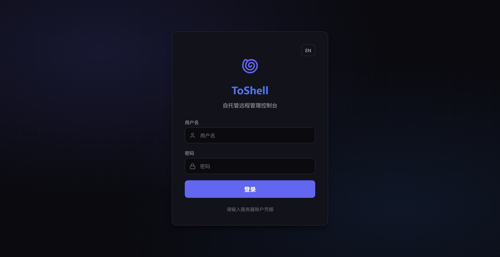

**仪表盘**：会话/任务概览、图表与实时状态。

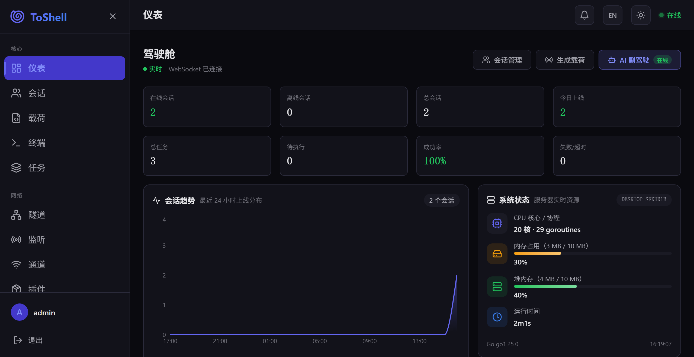

**会话管理**：多平台会话、任务下发与状态跟踪。

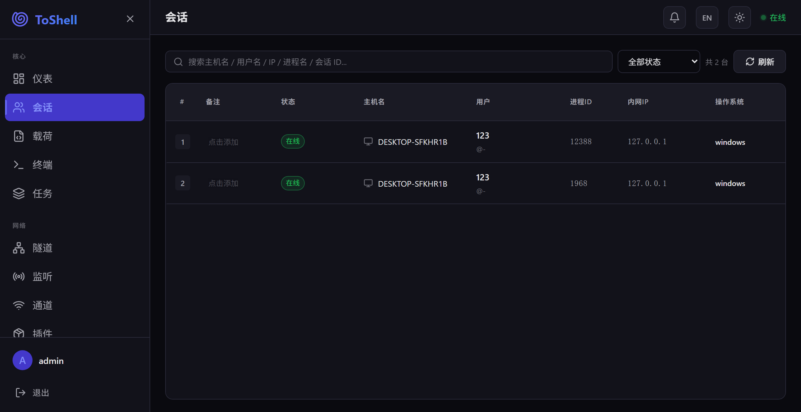

**会话详情**：标签条由**载荷上报的能力位**决定 —— 这台是 `full` 载荷（14 个标签），`light` 载荷只显示 6 个。

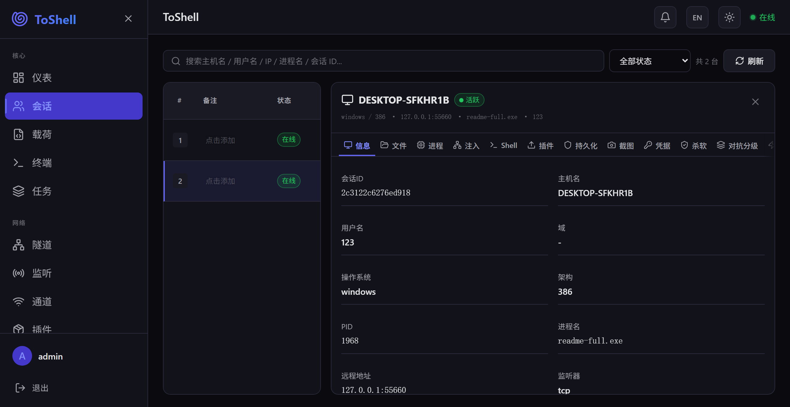

**会话详情（`light` 档载荷 —— 这里的 light 指载荷档位，与亮色主题无关）**：同一台机器上的 `light` 会话只有 6 个标签 —— 未编译进载荷的能力**不会**显示成空面板。

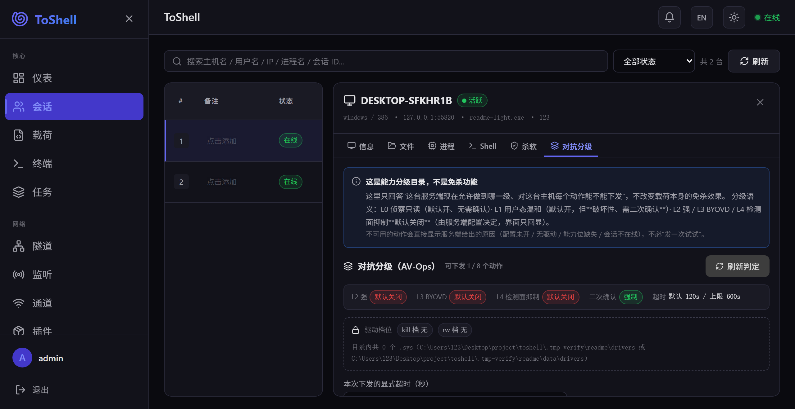

**交互式shell**：动态交互式shell独立标签页面。

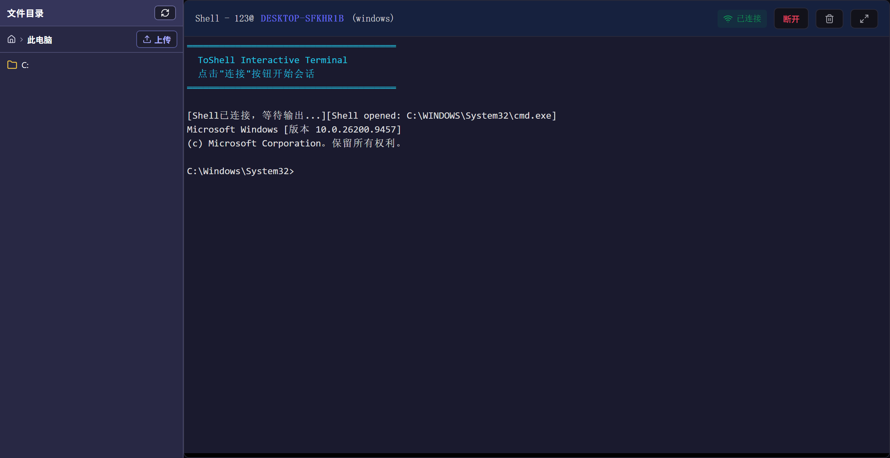

**文件管理**：上传 / 下载 / 在线预览，断点续传。

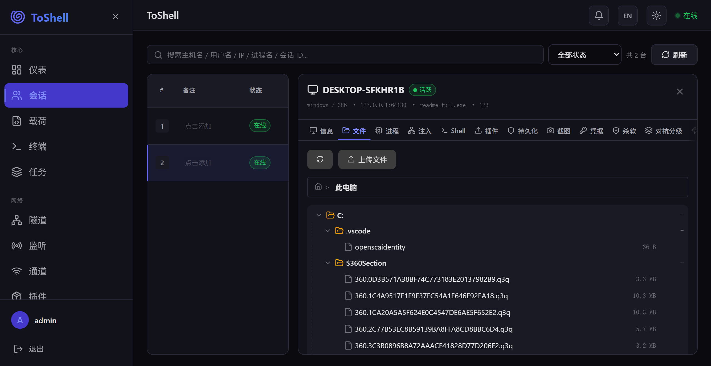

**内存执行**：免落地加载 DLL / EXE / BOF（`exe_mem` / `dll` 已加固：被映射程序退出不再带走宿主）。

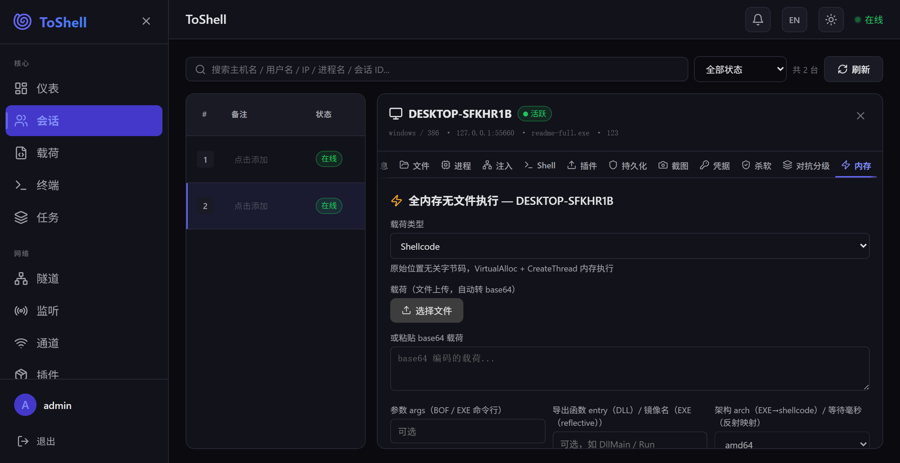

**杀软识别**：检测目标环境杀软 / 安全监控进程，辅助规避。

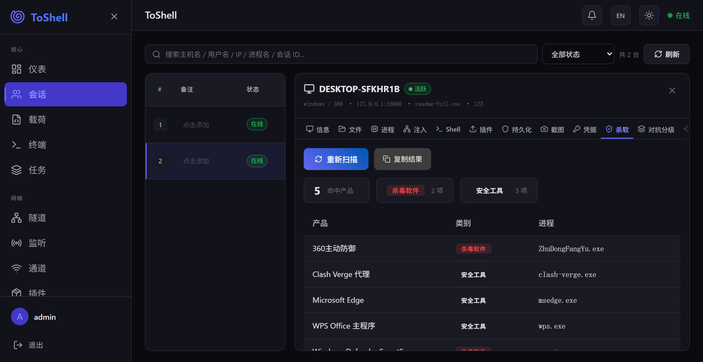

**对抗分级（AV-Ops）**：按 L0~L4 列出动作与「当前能不能下发」的中文原因，破坏性动作二次确认。

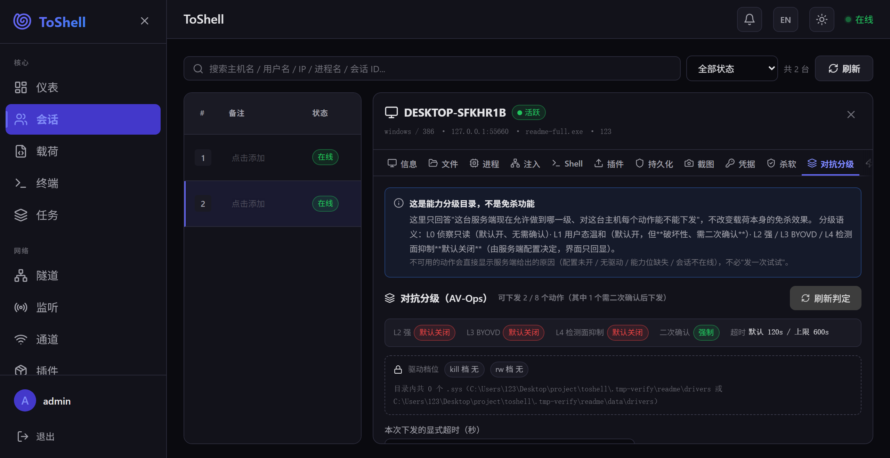

**AI 副驾驶**：真实模型对话（接入两个真实回连会话，含 `session_list` / `session_context` 工具调用轨迹与下一步建议）。

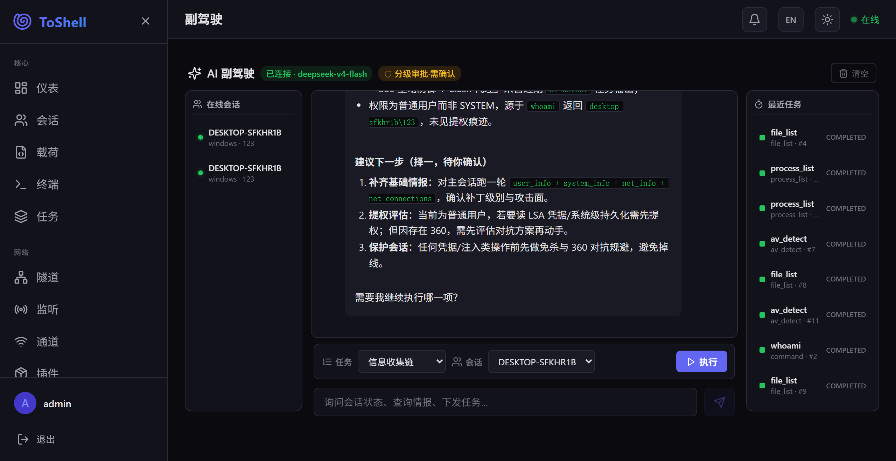

**生成载荷 · PE 版本资源**：图标 / 版本信息 / 时间戳（可选，默认不注入），与代码签名、UPX 的先后顺序在页面上写明。

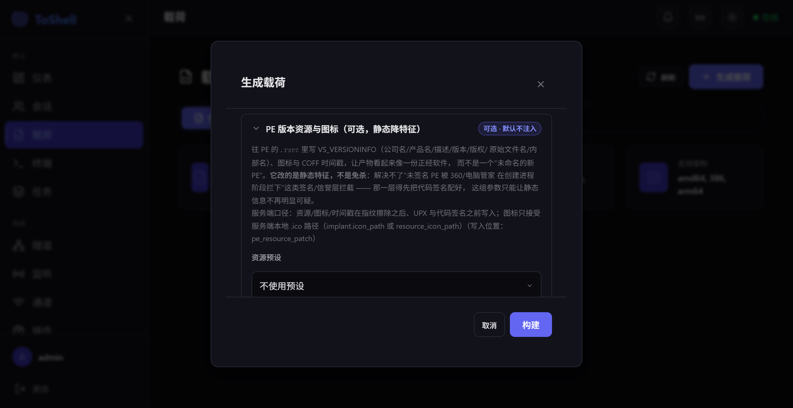
**进程列表**：真实目标机的进程清单（本机实测 350+ 条），可按名称过滤、直接结束进程或对指定 PID 发起注入。


**隧道 / 代理**：SOCKS5 动态代理，支持可选认证（RFC 1929）；代理**落库持久化**，服务端重启后自动重建监听。


**通道状态**：四类通道的在线情况，以及 v1.4.1 新增的 `screen_stream` 投递计数（收帧 / 投递 / 丢弃 / 订阅者数）。


**设置**：分 4 个分页；每个配置分组**默认折叠**（v1.4.1 起），点标题再展开，一页不再铺开十几个控件。


**关于**：版本、许可与文档入口（`v1.4.1`），以及对本项目有过帮助的早期开源 C2 项目（VShell）的致谢。


**关于**：版本、许可与文档入口（`v1.4.1`，含对早期开源 C2 项目 VShell 的致谢）。

## 使用前准备

### 环境依赖

下面按**用途**列出需要安装的工具。只有对应功能用到时才需要，基础运行只装 **Go** 即可。

| 用途 | 依赖 | 说明 |
|---|---|---|
| **构建 / 运行服务端** | [Go](https://go.dev/dl/) **≥ 1.25**（go.mod 为 `go 1.25.0`） | 必需。服务端 + 植入端都用它编译。 |
| **源码构建时嵌入 Web 界面** | [Node.js](https://nodejs.org/) **≥ 20** + npm | 仅当从源码构建并带前端时用 `-tags webui`。发行版自带前端，可跳过。 |
| **构建 C 植入端（体积极小）** | [mingw-w64](https://www.msys2.org/) gcc（`x86_64-w64-mingw32-gcc`） | 仅生成 C 植入端时需要。普通 Go 植入端不依赖。 |
| **字符串混淆（可选）** | [garble](https://github.com/burrowers/garble) | 可选。未装则候选载荷自动禁用混淆。 |
| **UPX 压缩（可选）** | UPX | 发行版 `upx/` 目录已内置，自动探测。未装则候选载荷不启用压缩。 |

> **Go 工具链**：服务端用当前 Go 版本编译；植入端模板锁定 go1.20 工具链，构建时自动下载对应版本，无需手动安装。

### 安装步骤

**Windows**
```bash
# 1) 安装 Go（下载安装包或 winget）
winget install GoLang.Go

# 2) （可选，C 植入端）安装 MSYS2，并在其中安装 mingw-w64 工具链
#    MSYS2 安装后执行: pacman -S mingw-w64-x86_64-gcc

# 3) （可选，字符串混淆）
go install mvdan.cc/garble@latest
```

**Linux / macOS**
```bash
# Debian/Ubuntu / macOS (Homebrew)
sudo apt install -y golang-go                    # Linux
# brew install go                                 # macOS

# （可选，C 植入端）mingw-w64
sudo apt install -y gcc-mingw-w64-x86-64         # Linux
# brew install mingw-w64                          # macOS

# （可选，字符串混淆）
go install mvdan.cc/garble@latest
```

> 确认安装成功：`go version` 应输出 ≥ 1.25；`go env GOPROXY` 可设国内镜像加速依赖下载（如 `https://goproxy.cn,direct`）。

## 快速开始

### 一键部署（推荐）

```bash
cd release && chmod +x deploy.sh && ./deploy.sh   # Linux / macOS
# Windows: 在 release 目录双击 deploy.bat
```

> 首次运行会基于 `server.yaml.example` 自动生成配置，请先修改敏感项。完整部署说明见 [USAGE.md](USAGE.md)。

> **想用域名 + CDN 上线？** 见 [docs/DEPLOY-DOMAIN-CDN.md](docs/DEPLOY-DOMAIN-CDN.md)：CDN 回源、Nginx 反代、域前置（Domain Fronting）三种方式与排错 FAQ。

### 默认启动方式

服务端是一个**单一可执行文件**，无需安装任何服务，直接运行即可：

```bash
# Linux / macOS
./toserver -config configs/server.yaml

# Windows
toserver.exe -config configs\server.yaml
```

启动后浏览器打开 **http://<服务器IP>:18081**（`server.api_port`，默认 18081）进入 Web 控制台。

> 首次启动会自动创建 SQLite 数据库 `./data/toshell.db`；未指定 `-config` 时默认加载 `./configs/server.yaml`。

### 从源码构建

```bash
# 在项目根目录，构建服务端（嵌入已构建的 Web 前端需先 npm run build）
go build -tags webui -ldflags "-s -w" -o toserver ./cmd/server
```

> 仅构建后端、不带前端（纯 API/无 Web 控制台）可去掉 `-tags webui`。

## 生成植入端

登录 Web 控制台 →「生成载荷」→ 选平台 / 通道 / 免杀配置 → 构建 → 目标机运行即回连。

### 构建档位与免杀边界（v1.4.0）

| 选项 | 默认 | 说明 |
|---|---|---|
| 构建档案 `profile` | `full` | `full` = 全功能；`light` = 裁剪截图/屏幕流/中继/BOF/凭据/持久化/EDR/BYOVD/UAC/注入/插件（体积小、特征少） |
| **代码签名 (Authenticode)** | 关（需先在服务端配证书） | **v1.3.5 新增**：构建后签名。未签名的新 PE 在装有 360/电脑管家的主机上会被拒绝执行 —— 这是"能不能跑起来"的敲门砖；配 `builder.sign_pfx_path`(+密码) 或 `builder.sign_thumbprint` |
| **BOF 支持** | **关** | **v1.3.5 起按需编译**：开启会带上整套 Cobalt Strike `Beacon*` API 名字（实测 22 处明文），只有确实要跑 BOF 才勾 |
| 启动随机延迟 | 服务端配置（默认 2~10s） | 载荷启动后随机休眠 [最小,最大] 秒再首次回连；**生成载荷页留空即跟随服务端**（填了才覆盖。注意 0 = "未设置"，仍回退配置值，不是"不延迟"） |
| 回连节奏：心跳间隔 / 抖动 / 重试 | 服务端配置（`implant.interval` / `jitter` / `retry_wait`） | **生成载荷页这些输入框默认留空**，留空 = 跟随「设置 → 植入端默认参数」，placeholder 直接显示服务端当前生效值；只有确实要覆盖时才填。未配置时回退 60s / ±20% / 5s |
| 主动反沙箱进程检测 | **关** | 开启（`evasion_scan`）会枚举全系统进程并与一批杀软/分析工具进程名比对后延迟执行 —— **这正是 360/火绒/电脑管家主动防御拦截的对抗行为**，只在明确需要时开 |
| **PE 版本资源 / 图标 / 公司信息 / 时间戳** | **不注入** | **v1.4.0 新增**：往 `.rsrc` 写 `RT_VERSION`（公司名/产品名/文件描述/版本/版权/原始文件名/内部名）+ `RT_ICON(3)`/`RT_GROUP_ICON(14)`，并可覆盖 COFF `TimeDateStamp`（`keep`/`fixed`/`random`）。只吃**服务端本地** `.ico` 路径（**不接受客户端上传字节**）；写入位置 `pe_resource_patch` 固定在**指纹擦除之后、UPX 与签名之前**（资源在 UPX 之后补会改坏压缩结果，签名之后再动一个字节就是白签）。一键预设 `resource_preset=neutral` 只填**你没显式给**的字段，且**明确不预置"像系统组件"的外观**；预设名拼错**直接构建报错**而不是静默产出无资源文件。只对 Windows `exe` / `bin` / `dll` 生效，C 植入端（mingw）**未接入** |
| **内存模块 `exec_module`** | **关** | **v1.4.0 新增**：勾选后服务端以 **`-tags execmodule`** 编译载荷（不带该 tag 的载荷收到模块任务会明确回"`exec_module` 未包含在本次构建中"，而不是 `Unknown task type`）。与档案无关 —— **`light` + `execmodule` 是推荐组合**：载荷保持最小，功能模块经加密 C2 下发到内存执行、且可在服务端更新而不必重编载荷。模块格式硬约束：**只接受原生 PE（C + `-nostdlib`）**，Go/CLR/带 TLS 目录的一律硬拒（宿主是反射映射，第二个 Go runtime 会互踩） |
| Garble 混淆 / UPX | 关 | 未安装对应工具时界面上如实显示"不可用 + 原因"。注意：**签名后再 UPX/改资源会让签名失效** |

> **默认载荷里已经没有这些高信号明文**（实测）：`beacon*`（BOF 按需编译）、`loadShellcode`/`memexe_windows.go` 等（pclntab 中性化）、`\xff Go buildinf:` 与 `Go build ID:`（构建期指纹擦除）、杀软进程名（字符串混淆 + 默认不枚举进程）。

> **如何确认参数真的生效**：服务端日志有 `rendering implant: … interval=… jitter=… startup_delay=… evasion_scan=… profile=…`、`compiling implant: … tags="…"`、`交付流水线（字节加工顺序，签名必须是最后一步）：scrub_fingerprint → scrub_version_string → section_normalize …`（开了资源注入会在 UPX/签名之前多一步 `pe_resource_patch`）、`代码签名成功（…）` 与 `go fingerprint scrubbed: …`，这是唯一可信的"真正烘焙进载荷的值"。

### 植入端体积（v1.4.0 本机实测）

口径：**windows / 386、`exe`、go1.20.14、不启用 garble / UPX / BOF / evasionscan**，本次用构建器逐档直接构建实测（与 `scripts/pe_footprint.ps1` 同一套口径）：

| 档位 | 体积 | 相对 `light`+tcp |
|---|---|---|
| `light` + tcp | **2,946,805 B**（≈2.81 MB） | — |
| `light` + tcp + `execmodule` | 2,973,941 B | **+27,136 B**（这门控的代价） |
| `full` + tcp | **3,522,293 B**（≈3.36 MB） | **+575,488 B**（全部可选功能 tag 之和） |
| `light` + http | 5,455,613 B（≈5.20 MB） | +2,508,808 B |
| `light` + websocket | 5,097,728 B（≈4.86 MB） | +2,150,923 B |
| `light` + mqtt | 5,399,798 B（≈5.15 MB） | +2,452,993 B |

**结论（如实）**：
- 体积大头是**传输栈**（http / websocket / mqtt 相对 tcp 各 **+2.15~2.51 MB**），而**全部功能 tag 加起来只有 +0.58 MB**。
  所以 `exec_module` 买到的是"**最小载荷按需拿到全功能 + 模块可服务端更新**"，**不是**把 2.8 MB 压到很小；真正省体积的第一选择是**留在 tcp 档**。
- **"nano ≤1.8 MB 的 Go 植入端"在当前架构下做不到**：Go runtime + 最小 TCP 传输栈的地板就在 **2.8 MB 附近**，
  再往下要动的是"不用 Go"或者"把传输栈也模块化"（后者已被否决：模块化传输栈会让最常用的回连路径多一次下发与失败面）。
  这条如实写在这里，避免把"体积分档"误解成"能做到 1 MB 级"。

> 注：上表是**发布版（v1.4.0）工作区代码**的本机实测口径；[CHANGELOG.md](CHANGELOG.md) 的 S4 段与本文同口径，
> 只记相对增量（`execmodule` 门控 +27,136 字节、`full` 相对 `light` +575,488 字节），绝对体积以本表为准。

> ⚠️ **必须知道的边界**：在装有 360/电脑管家等国产安全软件的主机上，**未签名的 PE 会在进程创建阶段被直接拒绝执行并删除文件**（实测：连一个只有 `time.Sleep` 的 Hello-World Go 程序也被拒，而微软签名的 `notepad.exe` 副本可正常执行）。这属于"签名/信誉/策略"拦截，**改载荷代码无用**。v1.3.5 给出的解法是：
> 1. **签名**：配好证书后勾选「代码签名」重新构建（自签名证书还需导入目标机「受信任的根证书颁发机构」，否则状态是"已签名但链不受信任"，仍可能被拦）；
> 2. **不落地未签名 PE**：用生成载荷页给出的 **8 条加载器链**（白加黑 DLL 侧加载 / 计划任务 + 已签名宿主 / rundll32·mshta·certutil / 内存加载 shellcode），详见 **[docs/LOADERS.md](docs/LOADERS.md)**；
> 3. 构建响应会按"是否已签名 + 平台/格式"给出 `loader_advice_title/tips`，写明**降级顺序**：直接运行 → 计划任务 → 白加黑 → 内存加载。

## 配置

复制 `configs/server.yaml.example` → 修改 `public_host / api_keys / jwt_key / encryption_key / admin_password`；更多字段说明见 [USAGE.md](USAGE.md)。设置页可热更新多数配置（无需重启）。

### v1.4.0 新增 / 需要留意的配置段

```yaml
mcp:                              # 对外 MCP 协议服务（**默认整段关闭**）
    enabled: false                # 打开后也只绑回环；token 为空则拒绝启动（不允许无鉴权裸奔）
    bind: 127.0.0.1:18082         # 端点 POST /mcp，不要设成 0.0.0.0 除非你清楚风险
    token: ""                     # Bearer / X-MCP-Token；设置页里 token 只写不回显（空串=保持，clear=清空）
    allowed_tools: []             # 留空 = 只放行只读工具（注册表 read 档 13 个）；写工具名才逐项放行
    allow_cidrs: []               # 来源网段白名单（不读 X-Forwarded-For，避免伪造绕过）
    max_rpm: 120                  # 每 token 每分钟上限
    inline_limit: 8192            # 结果内联上限（字节），超出落盘成句柄，用 result_read 分页回读
    result_dir: ./data/mcp-results
    result_ttl: 24h
    audit_path: ./logs/mcp-audit.jsonl
avops:                            # 杀软对抗能力分级（**出厂 fail-closed**）
    allow_l2: false               # L2 强：结束安全软件 / 进程
    allow_l3: false               # L3 BYOVD / PPL 清除（驱动仍由操作员自备，项目不内置）
    allow_l4: false               # L4 检测面抑制（当前无落地动作，打开也不会放行任何动作）
    require_confirm: true         # 需确认的动作必须带 confirm=true（**指针语义**：没配也按 true）
    default_timeout_sec: 120      # 服务端看门狗超时
    max_timeout_sec: 600          # 超上限直接 400 拒绝，不截断
listener:
    ws_path: /                    # WS **只对这一条路径**升级；改它必须同步改植入端 server_url
    ws_host_allowlist: []         # 空 = 不检查；非空时非名单 Host 直接 404 不升级（可配合 front_domain）
```

> 会话能力位（`GET /api/v1/sessions/{id}/capabilities` 与详情页标签）来自**载荷上报**，服务端只对老载荷按
> 操作系统兜底并标注 `source: reported|os_fallback`；`exec_module` 由载荷编译 tag 决定，**不是**配置项。

## 发版前自检

```powershell
pwsh -NoProfile -ExecutionPolicy Bypass -File scripts/e2e_smoke.ps1
```

起临时服务端 → 校验鉴权/关键接口 → 构建 windows full / light / linux 三档载荷 → （可选）真植入端上线并下发一条任务 → 输出 ✅/⚠️/❌ 摘要，**有 ❌ 即非 0 退出**，可直接进 CI 作为发版门禁。

## 联系方式 / Contact

| 渠道 / Channel | 地址 / Link |
| :--- | :--- |
| 作者 / Author | 青山（iQingshan） |
| 交流群 / Group | **ToShell 测试群**（QQ 群，扫码加入，见下图） |
| GitHub | [@iQingshan](https://github.com/iQingshan) |
| 邮箱 / Email | [qingshan@88.com](mailto:qingshan@88.com) |
| Issue / 功能建议 | [提交 Issue](https://github.com/iQingshan/Toshell/issues) |
| 安全 / 滥用报告 | [SECURITY.md](SECURITY.md)（**不要**在公开 Issue 里贴可利用细节，可走邮件） |
| 个人主页 / Profile | [github.com/iQingshan](https://github.com/iQingshan) |

**交流群（ToShell 测试群）** —— 装不上、跑不通、想聊思路都可以进群；**能复现的 Bug 仍建议提 Issue**，这样别人也能搜到答案。


> 使用问题、配置排查、功能建议：优先提 Issue（附版本、系统环境、复现步骤与相关日志），这样别人也能搜到答案。
> 商务合作 / 授权咨询 / 漏洞披露：邮件联系。
>
> *Bug reports and feature requests: please open an issue with version, environment and reproduction steps.*
> *Security disclosures / business & authorization enquiries: email [qingshan@88.com](mailto:qingshan@88.com).*

## 致谢 / Acknowledgements

- **[VShell](https://github.com/veo/vshell)** —— 早期开放源码的老牌 C2 项目（后续已闭源）。它的公开设计与工程取舍帮我们把"这个领域到底该有哪些东西、我们自己缺什么 / 多做了什么"想清楚了：v1.4.1 的**隧道持久化、批量操作、屏幕流投递计数**三个改进点，就是拿它的设计做对照后补上的（对比可见 [docs/VSHELL-ANALYSIS.md](docs/VSHELL-ANALYSIS.md)）。
  **边界（重要）**：我们**只吸收设计思想**，没有复制它的任何代码、前端资源、协议常量或协议格式；分析文档里的 `文件:行` 引用仅用于让结论可核查，**不构成任何代码许可**。ToShell 的前端、协议、构建流水线均为自研。
- 以及所有提 Issue / 反馈现场问题的师傅们 —— 本版修的**乱码、Linux 用户名显示、文件预览后缀限制、代理认证、Linux/amd64 秒断**，都是照着你们的现场反馈定位的。

## 开源与授权

- 使用说明：[USAGE.md](USAGE.md)
- 后续优化路线：[ROADMAP.md](ROADMAP.md) —— 按**实战痛点**组织（上线就死 / 掉线 / 批量低效 / 证据导出 / 协作误操作 / 样本=身份），不写空话—— 其中**内存执行加固的 IAT 部分已在 v1.4.0 落地**，原计划的 inline hook 仍未做（风险大于收益，见 CHANGELOG 说明）。
- 安全披露：[SECURITY.md](SECURITY.md)
- 一键部署：[release/install.ps1](release/install.ps1) / [release/install.sh](release/install.sh)（发布包内自带，环境检测 + 按需在线安装 + 直接启动）
- License：**[MIT](LICENSE)**（Copyright © 2026 iQingshan 与 ToShell 贡献者）
- 使用声明：**[DISCLAIMER.md](DISCLAIMER.md)** —— 仅限**授权**安全测试/红队演练/自建实验环境，禁止任何未授权用途；使用者须自行确保授权充分并承担全部责任。
- 第三方组件声明：**[THIRD-PARTY-NOTICES.md](THIRD-PARTY-NOTICES.md)** —— 发布包内捆绑的 **UPX（GPL-2.0-or-later + 特殊例外）**以及 Go 模块依赖的许可清单；发布包与二进制**不含任何内核驱动**（BYOVD 驱动由使用者自备并自负合规责任），第三方组件**不受 MIT 覆盖**，各自遵循原许可。
- **免责声明**：仅用于授权测试与学习研究，禁止任何未授权的入侵、攻击或数据窃取行为；使用者后果自负。

---

**© 2026 ToShell · MIT License** · 仅供授权测试与学习
